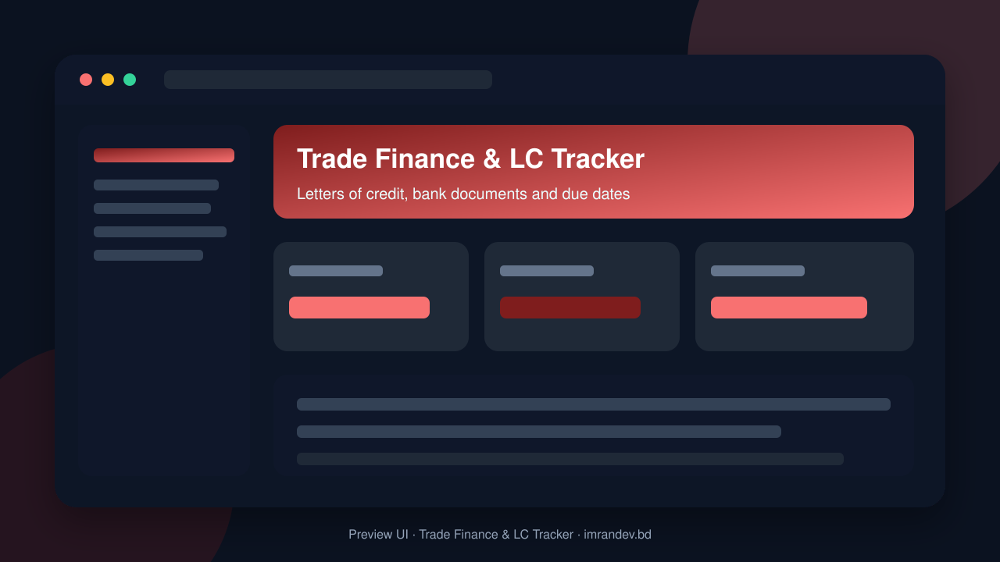
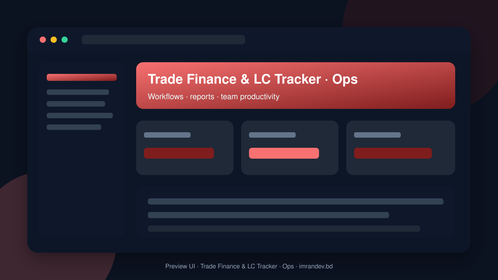

<p align="center">
  
</p>

<h1 align="center">Trade Finance & LC Tracker</h1>

<p align="center"><strong>Letters of credit, bank documents and due dates</strong></p>

<p align="center">
  <a href="https://github.com/imranbru99/trade-finance-lc-tracker-bank-documents"></a>
  
  
</p>

---

## Overview

**Trade Finance & LC Tracker** is a complete business application focused on real operational workflows. This README lists the full feature surface so GitHub visitors and search engines can understand every capability of the product.

## Product preview

| Dashboard | Operations |
| :---: | :---: |
|  |  |

## Complete feature list

### Product modules & capabilities

- Trade Finance and LC Tracker
- Trade Finance Domain Specialist
- AI Integration Engineer
- Cybersecurity Engineer
- DevOps Engineer
- QA Automation Engineer
- Tenant security
- Trade Finance Modules
- Module management requirements
- LC creation
- LC status management
- Import LC dashboard
- Commercial Invoice
- Correspondence management
- Import Manager
- Trade Finance Manager
- Finance Manager
- Reports
- Business systems
- Export Manager
- Finance Officer
- Branch Manager
- Module management
- Trade finance
- System
- Security Tests
- TradeFinance
- Payments
- Reporting
- Security

### Admin / Filament resources

- Ai Extraction
- Approval Request
- Audit Log
- Bank Correspondence
- Bank
- Branch
- Cms Page
- Company
- Counterparty
- Deadline
- Discrepancy
- Document
- Export Lc
- Import Lc
- Integration Connection
- Knowledge Article
- Lc Amendment
- Module Catalog
- Organization
- Payment Schedule
- Shipment
- Subscription Plan
- Task
- User
- Webhook

### Domain models

- Ai Assistant Session
- Ai Document Job
- Ai Extraction
- Approval History
- Approval Request
- Approval Workflow
- Audit Log
- Bank
- Bank Branch
- Bank Charge
- Bank Contact
- Bank Correspondence
- Belongs To Organization
- Branch
- Cms Page
- Company
- Counterparty
- Currency Rate
- Deadline
- Department
- Discrepancy
- Discrepancy Resolution
- Document
- Document Approval
- Document Category
- Document Comment
- Document Version
- Escalation Rule
- Export Lc
- Financial Exposure
- Import Lc
- Integration Connection
- Invoice
- Knowledge Article
- Lc Amendment
- Lc Document Requirement
- Lc Status History
- Module
- Notification Log
- Organization
- Payment Record
- Payment Schedule
- Permission
- Reminder
- Role
- Shipment
- Subscription
- Subscription Plan
- Task
- Task Comment

### HTTP / API controllers

- Deadline APIs & screens
- Discrepancy APIs & screens
- Document APIs & screens
- Document Download APIs & screens
- Export Lc APIs & screens
- Import Lc APIs & screens
- Payment APIs & screens
- Public Site APIs & screens
- Report APIs & screens
- Shipment APIs & screens

### Detailed feature requirements delivered

- Application Name: Trade Finance and LC Tracker
- PRIMARY BUSINESS VISION
- TECHNOLOGY STACK
- REQUIRED COMPOSER PACKAGES
- Recommended starting target: PHP 8.3, Laravel 12, and a Composer-verified compatible Filament release.
- MULTI-TENANT SAAS ARCHITECTURE
- MULTIPLE USER TYPES AND ROLE MANAGEMENT
- COMPLETE BUSINESS MODULE SYSTEM
- IMPORT LC MANAGEMENT
- EXPORT LC MANAGEMENT
- LC AMENDMENT MANAGEMENT
- DOCUMENT MANAGEMENT SYSTEM
- AI DOCUMENT INTELLIGENCE
- DEADLINE AND EXPIRY TRACKING
- CALENDAR AND DEADLINE CENTER
- SHIPMENT AND LOGISTICS MANAGEMENT
- DOCUMENT DISCREPANCY MANAGEMENT
- BANK MANAGEMENT AND CORRESPONDENCE
- PAYMENT AND MATURITY TRACKING
- APPROVAL WORKFLOW ENGINE
- TASK AND WORKFLOW MANAGEMENT
- FINANCIAL REPORTS AND ANALYTICS
- MULTI-CURRENCY AND INTERNATIONALIZATION
- EXTERNAL INTEGRATIONS
- PUBLIC WEBSITE AND MARKETING PAGES
- SAAS SUBSCRIPTION AND BILLING
- PLATFORM SUPER ADMIN PANEL
- TENANT ADMIN PANEL
- DEMO USERS AND DEMONSTRATION ENVIRONMENT
- Company: Global Trade Solutions Ltd.
- Industry: Import and Export.
- Country: Bangladesh.
- Currency: USD / BDT.
- DATABASE ARCHITECTURE
- SECURITY AND DATA PROTECTION
- PUBLIC API AND WEBHOOK SYSTEM
- UI/UX DESIGN REQUIREMENTS
- Primary: Deep Navy Blue.
- Secondary: Professional Blue.
- Accent: Teal.
- Success: Green.
- Warning: Amber.
- Danger: Red.
- Neutral: Slate / Gray.
- CMS AND KNOWLEDGE BASE
- AUTOMATION ENGINE
- TESTING REQUIREMENTS
- PERFORMANCE REQUIREMENTS
- README.MD — COMPLETE PROJECT DOCUMENTATION
- PROJECT STRUCTURE
- DEVELOPMENT EXECUTION PLAN
- Phase 1: Repository Inspection and Architecture
- Phase 2: Foundation
- Phase 3: Core Trade Finance
- Phase 4: Document and Deadline Engine
- Phase 5: Advanced Trade Finance
- Phase 6: AI and Integrations
- Phase 7: Reporting and Analytics
- Phase 8: SaaS Platform
- Phase 9: Public Website
- Phase 10: Demo Environment
- Phase 11: Testing and Optimization
- Phase 12: Final Delivery
- FINAL ACCEPTANCE CRITERIA
- MOST IMPORTANT DEVELOPMENT RULES

### Platform capabilities

- Multi-role ready structure for operators, managers and admins
- Database migrations and seeders for demo-ready local setup
- Laravel architecture with services/controllers/models separation
- Responsive UI foundation (Blade / Filament where enabled)
- Environment-based config for local and production databases
- GitHub-ready documentation with visual product previews

## Tech stack

- PHP 8.2+ / Laravel
- Filament admin resources (where enabled)
- Vite asset pipeline
- SQLite/MySQL-ready database layer
- Migrations, seeders, and test-ready structure

## Quick start

```bash
git clone https://github.com/imranbru99/trade-finance-lc-tracker-bank-documents.git
cd trade-finance-lc-tracker-bank-documents
composer install
cp .env.example .env
php artisan key:generate
php artisan migrate --seed
npm install && npm run build
php artisan serve
```

## Repository

- GitHub: https://github.com/imranbru99/trade-finance-lc-tracker-bank-documents
- Developer: **Imran Ahmed** · https://imrandev.bd

---

## 🤝 Let's Connect & Collaborate

I am open to **Senior Remote Full-Stack Roles**, AI Platform Architecture Contracts, and Enterprise Technical Advisory.

**Timezone:** UTC+6 (Dhaka / Rangpur, Bangladesh) — flexible overlap with US, UK & EU hours.  
**Delivery:** Async-ready · Slack · Discord · Jira · GitHub · production-first accountability.

| Channel | Handle | Link |
| :--- | :--- | :--- |
| Portfolio | imrandev.bd | https://imrandev.bd |
| Packagist | imrandevbd | https://packagist.org/packages/imrandevbd/ |
| LinkedIn | imranbru99 | https://linkedin.com/in/imranbru99 |
| GitHub | imranbru99 | https://github.com/imranbru99 |
| WhatsApp | +880 1576-918420 | https://wa.me/8801576918420 |
| Email | me@imrandev.bd | mailto:me@imrandev.bd |
| X | @imrandev_bd | https://x.com/imrandev_bd |
| YouTube | @ImranDevBD | https://youtube.com/@ImranDevBD |
